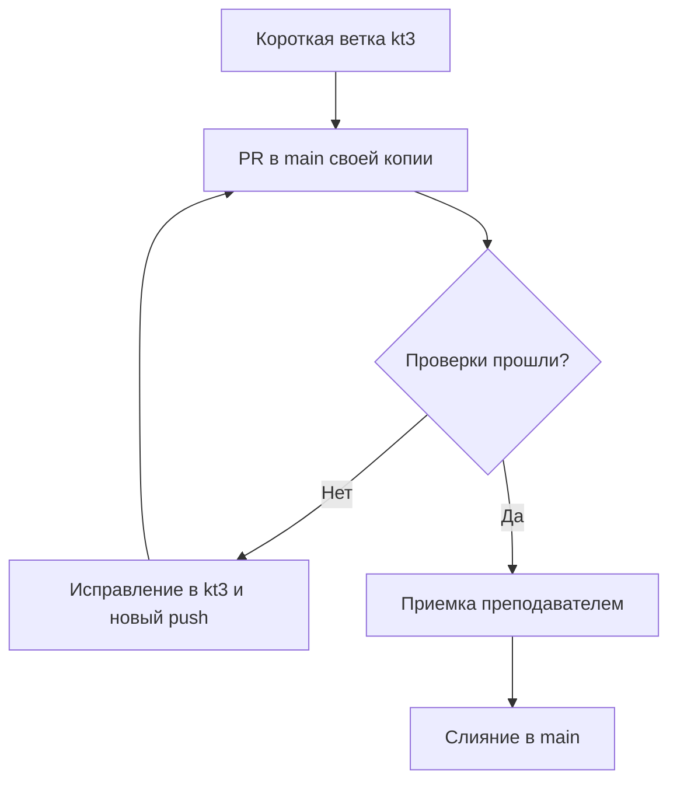

# K3-01. CI/CD и ветки

## Процесс CI/CD

Проверки будут запускаться в GitHub Actions при push и pull_request.

Сначала выполняются тесты командой:

`python -m unittest discover -s tests -p test_app.py -v`

Тест `test_create_request` проверяет создание заявки: ответ HTTP 201 и сохранение записи. После успешных тестов отдельный job будет собирать Docker-образ.

- **CI** — автоматическая проверка изменений.
- **Continuous Delivery** — подготовка проверенной версии к выпуску по отдельному решению.
- **Continuous Deployment** — автоматическое развертывание версии после успешных проверок.

В этой работе выполняются тесты и сборка. Развертывание не настроено, решение о выпуске принимается отдельно.

## Схема веток

## Сравнение с Git-flow

В Git-flow используются main, develop и отдельные ветки для функций, релизов и срочных исправлений.

Для учебного проекта я выбрал короткую ветку и PR в main. Эта схема проще: меньше переходов между ветками, легче проверить изменения и найти причину ошибки.

## Обратная связь

Об ошибке можно узнать после push, до слияния в main. Student CI покажет failed, а в логе будет указана причина ошибки теста или сборки.

## Ответ на вопрос

Сборка образа не является автоматическим deployment. Она создает образ, но не разворачивает приложение в рабочей среде.
